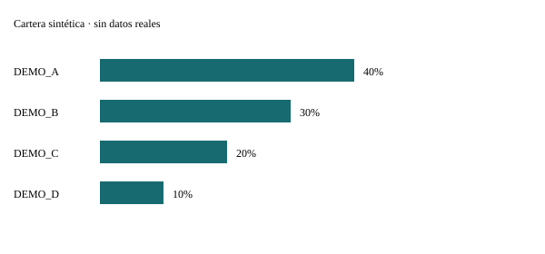

# IBKR Analytics — demo sintética

Datos inventados; no corresponden a una cuenta real.

| Métrica | Valor |
|---|---|
| market_value | 5,000.0000 |
| hhi | 0.3000 |
| effective_positions | 3.3333 |
| trade_count | 4.0000 |
| purchases_notional | 2,750.0000 |
| sales_notional | 550.0000 |
| gross_traded_notional | 3,300.0000 |
| commission_cost | 4.0000 |
| net_trade_cash_flow | -2,204.0000 |

El flujo de operaciones no es rentabilidad. La tabla de operaciones no reconstruye las posiciones de cierre.

